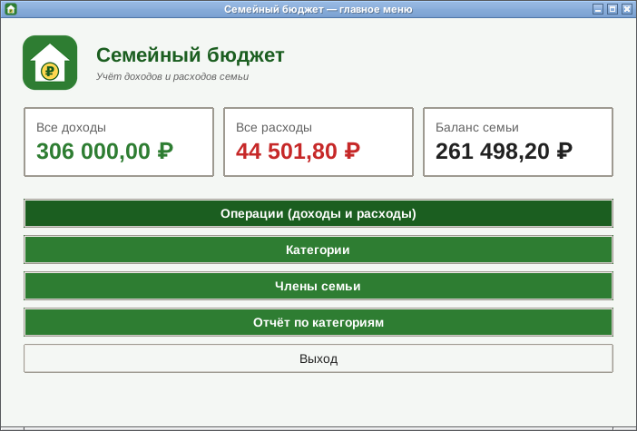
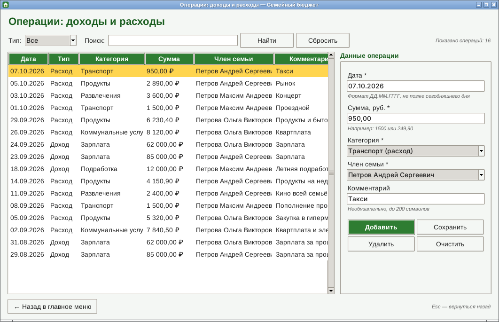
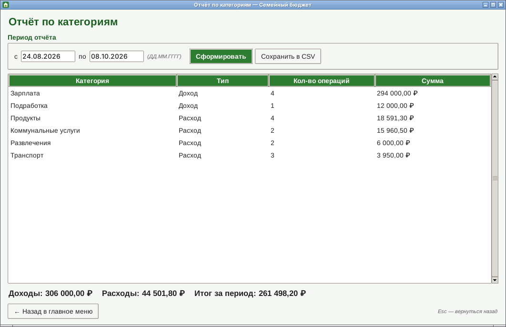
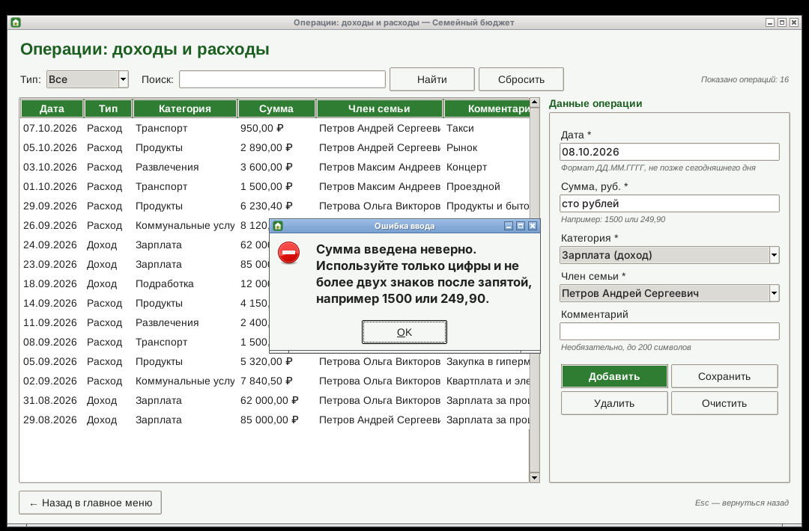
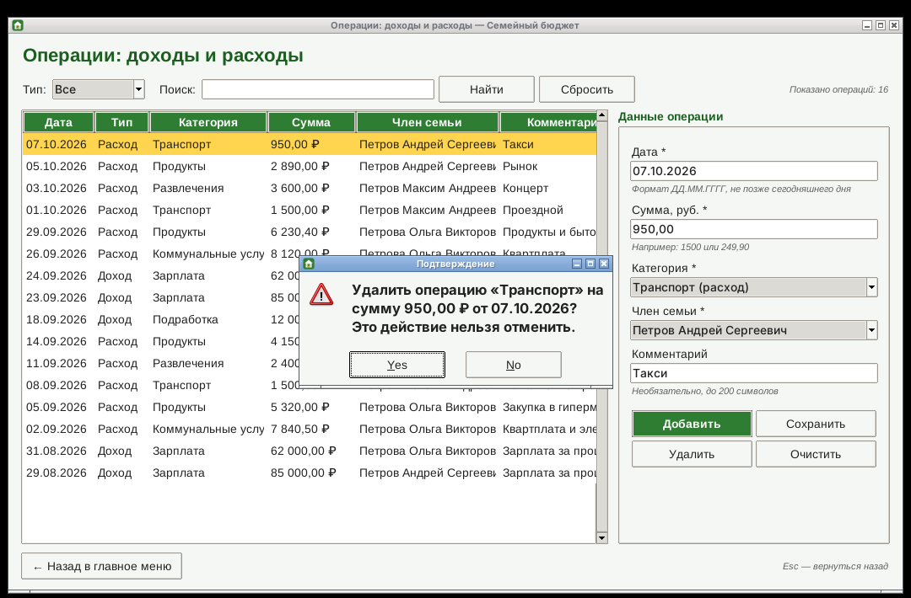

# Семейный бюджет

Десктопное приложение для учёта доходов и расходов семьи. Курсовой проект по дисциплине
«Создание программного обеспечения» (РТУ МИРЭА, Институт перспективных технологий
и индустриального программирования, кафедра индустриального программирования).

**Автор:** Боровиков Данил Владимирович, группа ЭФБО-18-24
**Тема:** Задание № 42 «Семейный бюджет»



## Возможности

- журнал операций: добавление, изменение и удаление доходов и расходов;
- фильтр операций по типу (доход / расход) и поиск по комментарию, категории и члену семьи;
- справочник категорий (статей доходов и расходов);
- список членов семьи — кто получил или потратил деньги;
- итоги на главном экране: все доходы, все расходы, текущий баланс;
- отчёт по категориям за выбранный период и сохранение отчёта в CSV (открывается в Excel);
- проверка всех вводимых значений с понятными сообщениями об ошибках;
- запрет опасных действий: нельзя удалить категорию или члена семьи, если у них есть операции;
- подтверждение перед удалением и предупреждение, если расход уводит баланс в минус;
- перехват непредвиденных ошибок: программа не закрывается аварийно, детали пишутся в `data/errors.log`.

## Технологии

| Что | Чем сделано | Почему |
|-----|-------------|--------|
| Язык | Python 3.10+ | простой и читаемый синтаксис |
| Интерфейс | Tkinter / ttk | входит в стандартную поставку Python |
| База данных | SQLite (модуль `sqlite3`) | одна база в одном файле, сервер не нужен |
| Тесты | `unittest` | входит в стандартную поставку Python |
| Сборка .exe | PyInstaller | один исполняемый файл для Windows |

Сторонние библиотеки для работы программы **не нужны**.

## Установка и запуск

1. Установите Python 3.10 или новее с сайта <https://www.python.org/downloads/>.
   При установке на Windows отметьте пункт **Add Python to PATH**.
2. Скачайте репозиторий (кнопка **Code → Download ZIP**) и распакуйте его в любую папку.
3. Запустите программу:
   - на Windows — двойной щелчок по файлу `run.bat`;
   - или из командной строки в папке проекта: `python main.py`.

При первом запуске создаётся папка `data` с файлом базы `family_budget.db` и набором
стандартных категорий. Чтобы сразу увидеть программу с примерами данных, выполните:

```
python tools/fill_demo_data.py
```

## Сборка исполняемого файла (.exe)

```
pip install -r requirements-dev.txt
build.bat
```

Готовый файл появится в папке `dist`: `dist/FamilyBudget.exe`. Его можно переносить
в любую папку — база данных создаётся рядом с ним.

## Запуск автоматических тестов

```
python -m unittest discover -s tests -t . -v
```

Тесты проверяют бизнес-логику на временной базе в оперативной памяти, рабочая база не затрагивается.

## Структура проекта

```
family_budget/
├── main.py                  # точка входа: создаёт базу, сервисы и главное окно
├── run.bat / build.bat      # запуск и сборка .exe на Windows
├── app/
│   ├── config.py            # пути к файлам (относительные) и ограничения на данные
│   ├── models/              # сущности: FamilyMember, Category, Operation, отчёты
│   ├── database/            # доступ к данным: подключение SQLite и SQL-запросы (репозитории)
│   ├── services/            # бизнес-логика: проверки, правила, расчёты итогов и отчётов
│   └── ui/                  # представление: стили, сообщения
│       ├── components/      # переиспользуемые элементы: таблица, панель формы
│       └── windows/         # окна приложения (одно окно — одна сущность)
├── resources/               # логотип и иконки приложения
├── tests/                   # автоматические тесты (unittest)
├── tools/                   # вспомогательный скрипт заполнения демо-данными
└── docs/                    # документация, диаграммы, скриншоты
```

Программа разделена на три независимых слоя:

1. **Представление** (`app/ui`) — окна, кнопки, обработка нажатий. SQL-запросов здесь нет.
2. **Бизнес-логика** (`app/services`) — правила задачи: проверка ввода, запреты, расчёты.
3. **Доступ к данным** (`app/database`) — только SQL-запросы к SQLite.

Подробнее — на [диаграмме архитектуры](docs/diagrams/architecture.png)
и [диаграмме последовательности](docs/diagrams/sequence_add_operation.png).

## Документация

- [Презентация проекта (PDF)](docs/presentation/presentation.pdf) · [PowerPoint](docs/presentation/presentation.pptx)
- [Руководство пользователя](docs/user_guide.md)
- [Техническое задание](docs/technical_specification.md)
- [Руководство по стилю интерфейса](docs/style_guide.md)
- [Диаграммы](docs/diagrams/)

## Скриншоты

| Операции | Отчёт по категориям |
|----------|---------------------|
|  |  |

| Ошибка ввода | Подтверждение удаления |
|--------------|------------------------|
|  |  |
